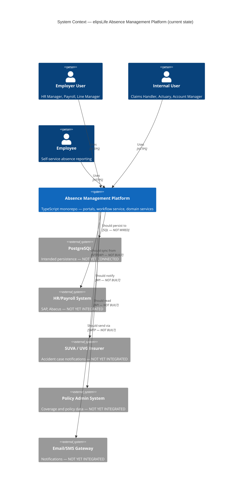
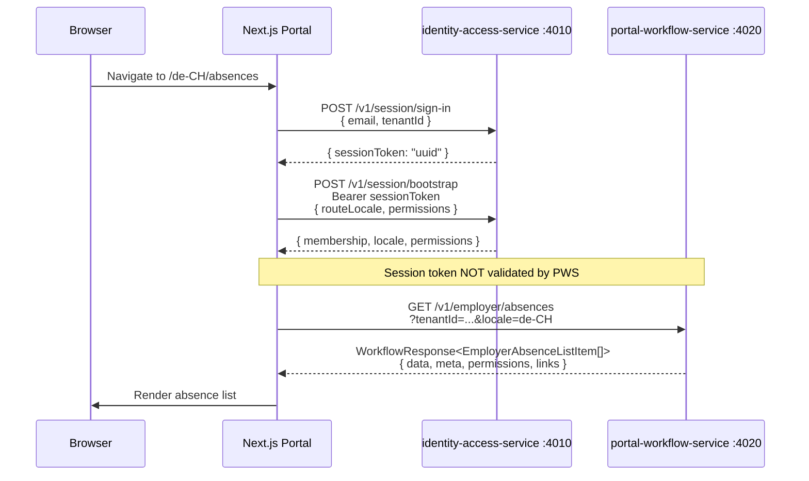
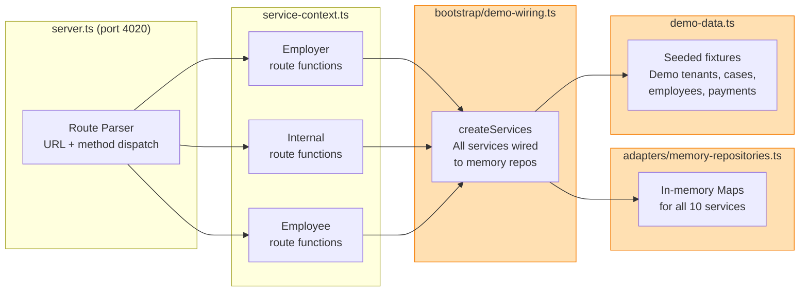
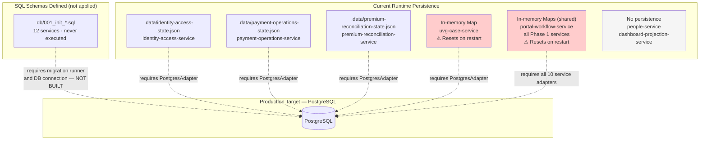
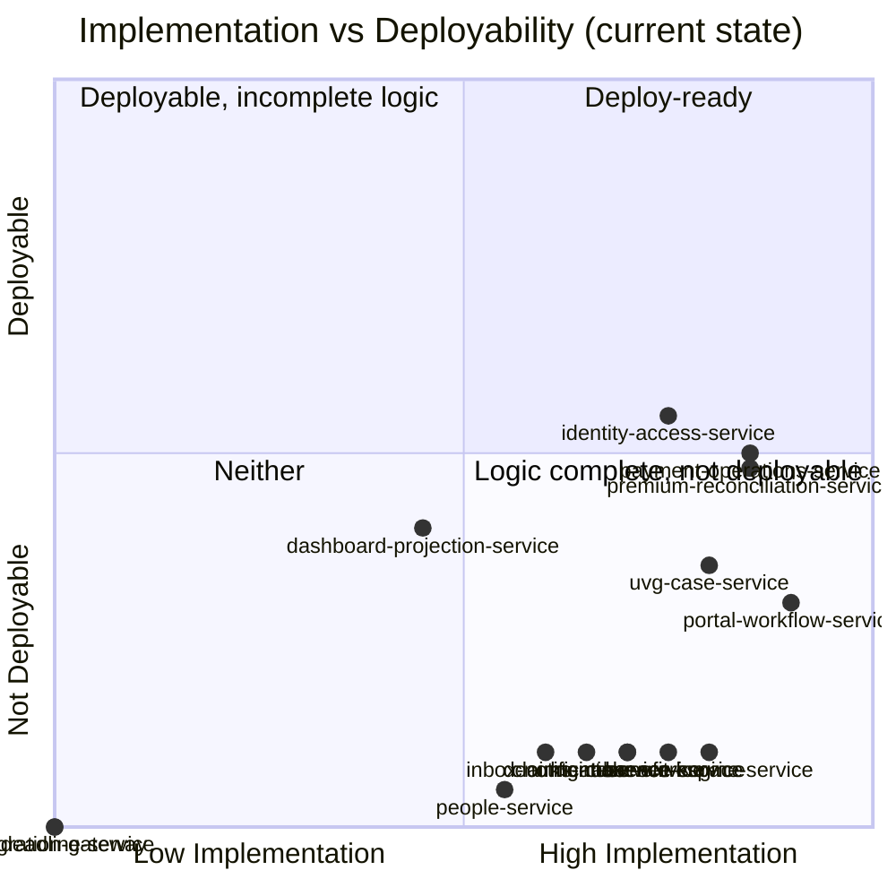
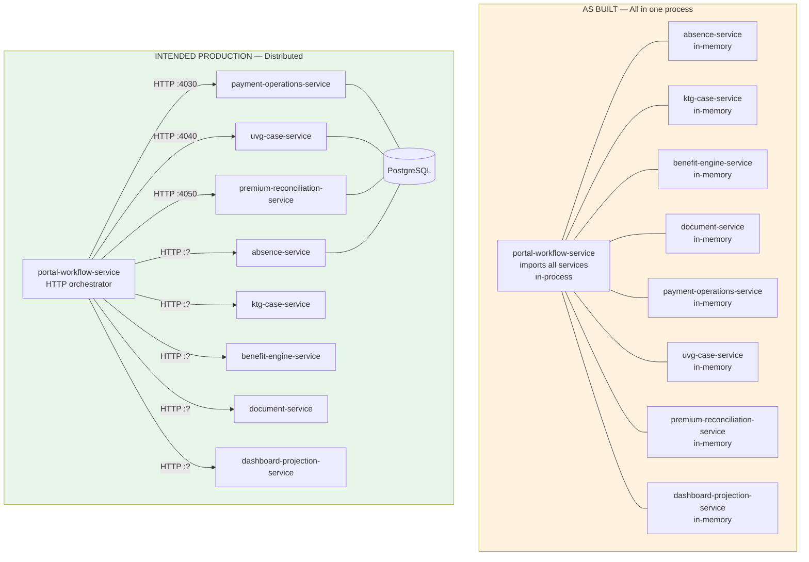
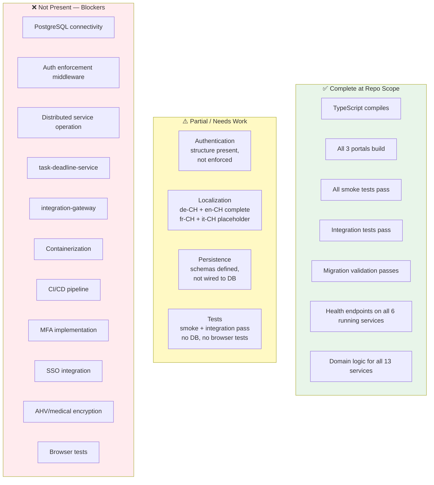

# Architecture Diagrams
## elipsLife Absence Management Platform — As Built

All diagrams use Mermaid syntax and reflect the actual current state of the codebase, not intended future state.

---

## Diagram 1: System Context

---

## Diagram 2: Monorepo Component Map

```mermaid
graph TB
    subgraph apps["apps/ — Frontend Applications (Next.js 15)"]
        EP[employer-portal<br/>:3000]
        IP[internal-portal<br/>:3001]
        EMP[employee-portal<br/>:3002]
    end

    subgraph pkg["packages/ — Shared Libraries"]
        FP[frontend-platform<br/>Shell, locale, nav]
        PWC[portal-workflow-client<br/>Route contract types]
        IAC[identity-access-client<br/>HTTP SDK]
        RB[runtime-baseline<br/>Health, logging, errors]
    end

    subgraph svc_running["services/ — Running HTTP Services"]
        IAS[identity-access-service<br/>:4010 · file-backed]
        PWS[portal-workflow-service<br/>:4020 · in-memory demo]
        POS[payment-operations-service<br/>:4030 · file-backed]
        UVG[uvg-case-service<br/>:4040 · pure in-memory]
        PRS[premium-reconciliation-service<br/>:4050 · file-backed]
        DPS[dashboard-projection-service<br/>:4060 · health-only stub]
    end

    subgraph svc_domain["services/ — Domain-Only (No HTTP Runtime)"]
        PS[people-service]
        AS[absence-service]
        KTG[ktg-case-service]
        DS[document-service]
        INS[inbox-notification-service]
        CIS[claims-intake-workspace-service]
        BES[benefit-engine-service]
    end

    subgraph missing["NOT IN REPO"]
        TDS[task-deadline-service ❌]
        IGW[integration-gateway ❌]
    end

    EP --> FP
    EP --> PWC
    EP --> IAC
    IP --> FP
    IP --> PWC
    IP --> IAC
    EMP --> FP
    EMP --> IAC

    EP -->|HTTP| PWS
    IP -->|HTTP| PWS
    EMP -->|HTTP| PWS
    EP -->|HTTP| IAS
    IP -->|HTTP| IAS
    EMP -->|HTTP| IAS

    PWS -->|in-process| AS
    PWS -->|in-process| KTG
    PWS -->|in-process| DS
    PWS -->|in-process| INS
    PWS -->|in-process| CIS
    PWS -->|in-process| BES
    PWS -->|in-process| POS
    PWS -->|in-process| UVG
    PWS -->|in-process| PRS
    PWS -->|in-process| DPS

    IAS --> RB
    PWS --> RB
    POS --> RB
    UVG --> RB
    PRS --> RB
    DPS --> RB
```

---

## Diagram 3: Portal to Backend Interaction

---

## Diagram 4: Portal Workflow Service — Internal Architecture

The orange boxes represent the parts that must be replaced with real distributed service calls in production.

---

## Diagram 5: Persistence Mode Map

---

## Diagram 6: Phase and Module Implementation Map

---

## Diagram 7: Service Interaction Map (As Built vs Intended)

---

## Diagram 8: Release Readiness Overview

---

## Diagram 9: SQL Schema Coverage vs Runtime Coverage

```mermaid
gantt
    title Service Implementation Layers (filled = present, empty = missing)
    dateFormat X
    axisFormat %s

    section people-service
    SQL Schema    :done, 0, 1
    Domain Types  :done, 1, 2
    App Service   :done, 2, 3
    HTTP Runtime  :crit, 3, 4
    DB Adapter    :crit, 4, 5

    section absence-service
    SQL Schema    :done, 0, 1
    Domain Types  :done, 1, 2
    App Service   :done, 2, 3
    HTTP Runtime  :crit, 3, 4
    DB Adapter    :crit, 4, 5

    section ktg-case-service
    SQL Schema    :done, 0, 1
    Domain Types  :done, 1, 2
    App Service   :done, 2, 3
    HTTP Runtime  :crit, 3, 4
    DB Adapter    :crit, 4, 5

    section identity-access-service
    SQL Schema    :done, 0, 1
    Domain Types  :done, 1, 2
    App Service   :done, 2, 3
    HTTP Runtime  :done, 3, 4
    DB Adapter    :crit, 4, 5

    section payment-operations-service
    SQL Schema    :done, 0, 1
    Domain Types  :done, 1, 2
    App Service   :done, 2, 3
    HTTP Runtime  :done, 3, 4
    DB Adapter    :crit, 4, 5

    section uvg-case-service
    SQL Schema    :done, 0, 1
    Domain Types  :done, 1, 2
    App Service   :done, 2, 3
    HTTP Runtime  :done, 3, 4
    DB Adapter    :crit, 4, 5
```

---

## Diagram 10: Recommended Documentation Structure

```mermaid
graph TD
    ROOT[Repository Root]

    ROOT --> DOCS[docs/]
    DOCS --> MS[management-summary.md<br/>THIS FILE EXISTS]
    DOCS --> AO[architecture-overview.md<br/>THIS FILE EXISTS]
    DOCS --> SR[service-reference.md<br/>THIS FILE EXISTS]
    DOCS --> PMS[phase-module-status.md<br/>THIS FILE EXISTS]
    DOCS --> RIM[runtime-integration-model.md<br/>THIS FILE EXISTS]
    DOCS --> PM[persistence-migration.md<br/>THIS FILE EXISTS]
    DOCS --> TR[testing-release-readiness.md<br/>THIS FILE EXISTS]
    DOCS --> TD[technical-debt.md<br/>THIS FILE EXISTS]
    DOCS --> DIAG[diagrams.md<br/>THIS FILE]

    DOCS --> P1[phase-1/ — original module design docs]
    DOCS --> P2[phase-2/ — original module design docs]

    ROOT --> RUNBOOKS[runbooks/ — TO BE CREATED]
    RUNBOOKS --> RB1[service-startup.md]
    RUNBOOKS --> RB2[database-migration.md]
    RUNBOOKS --> RB3[incident-response.md]
    RUNBOOKS --> RB4[certificate-renewal.md]

    style RUNBOOKS fill:#fff9c4
    style RB1 fill:#fff9c4
    style RB2 fill:#fff9c4
    style RB3 fill:#fff9c4
    style RB4 fill:#fff9c4
```

